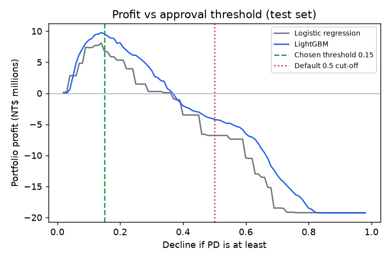
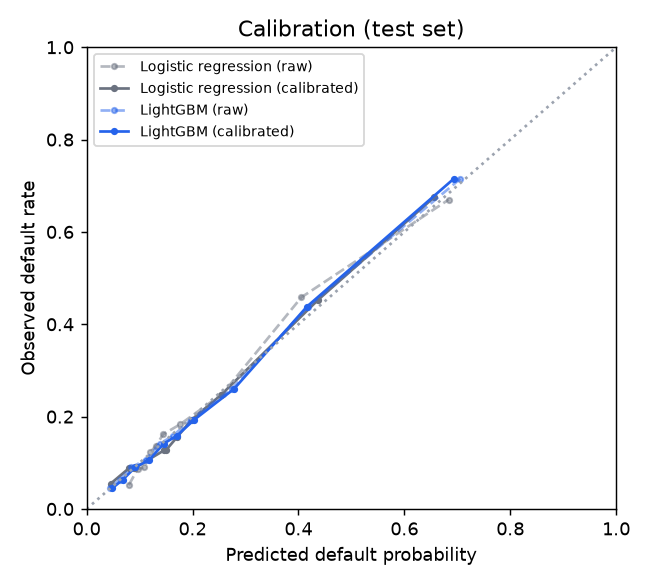
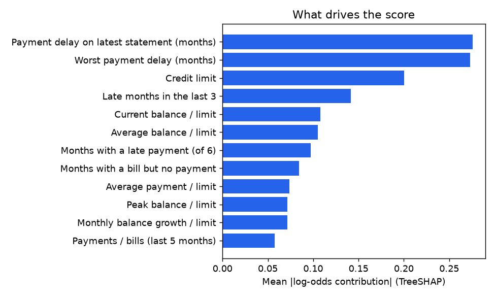

# Credit Risk Scoring: from SQL features to profit-optimal, explainable decisions

An end-to-end credit default model built the way a lender would need it: features engineered in SQL, a calibrated
LightGBM model benchmarked against logistic regression, an approval cut-off chosen by **money rather than accuracy**,
per-applicant **reason codes**, a **fairness audit** across attributes the model never sees, **drift monitoring**, a
FastAPI scoring service, a Streamlit dashboard, and an LLM that drafts customer letters **only from the computed
reasons**.

Data: [UCI "default of credit card clients"](https://archive.ics.uci.edu/dataset/350/default+of+credit+card+clients)
(30,000 Taiwanese card holders, 2005, 22.1% default the following month; CC BY 4.0).

## Results (held-out test set, 6,000 customers)

| Model | AUC (95% CI) | KS | Brier | Calibration error (ECE) |
|---|---|---|---|---|
| Logistic regression (baseline) | 0.771 (0.757 to 0.786) | 0.415 | 0.136 | 0.013 |
| **LightGBM, monotonic constraints** | **0.788 (0.773 to 0.803)** | **0.444** | **0.132** | 0.011 |

LightGBM beats the baseline by **+0.017 AUC (paired bootstrap 95% CI 0.010 to 0.024)**, so the gain is not noise.
Both models' calibration intervals overlap; both are within about one percentage point of observed default rates.

**The decision policy matters more than the model.** Each approval earns 4% of the credit limit if the customer repays
and loses 30% of it if they default (assumptions documented in the [model card](MODEL_CARD.md)):

| Approval policy (same LightGBM scores) | Approved | Default rate among approved | Profit on 6,000 applicants |
|---|---|---|---|
| Approve everyone | 100% | 22.1% | NT$ -19.3M |
| Decline if PD ≥ 0.5 (the usual default) | 88.5% | 16.0% | NT$ -4.2M |
| Decline if PD ≥ 0.118 (theoretical break-even) | 34.8% | 7.2% | NT$ +9.2M |
| **Decline if PD ≥ 0.15 (profit-optimal, chosen on validation)** | **46.6%** | **8.6%** | **NT$ +9.6M** |

The theoretical break-even cut-off lands close to the empirically optimal one only because the probabilities are
calibrated. That is why calibration is part of the pipeline rather than an afterthought.



| | |
|---|---|
|  |  |

## What makes it more than a notebook

| Concern | What the project does |
|---|---|
| **Feature engineering** | `creditrisk/features.sql` unpivots six monthly statements into a long table in DuckDB and aggregates delinquency, utilisation, repayment ratio and balance-trend features. The same query runs at training and serving time, so there is no train/serve skew. |
| **Model choice** | Logistic regression baseline vs LightGBM, with early stopping and a bootstrap test of the difference. |
| **Defensible behaviour** | Monotonic constraints: more late or missed payments can never lower risk, and paying more or in full can never raise it. Without them the model once listed "paid the full balance 6 of 6 months" as a risk factor. |
| **Calibration** | No calibration, Platt scaling or isotonic regression, chosen by 5-fold cross-validated ECE on the validation set. Isotonic was initially applied by default and overfit; the selection step fixed that. |
| **Decision** | The threshold maximises portfolio profit on validation and is reported on test against naive policies. |
| **Explainability** | TreeSHAP contributions (LightGBM `pred_contrib`) turned into ranked, plain-English reason codes. A test checks the contributions add up exactly to the model's log-odds. |
| **Fairness** | Sex, age, marital status and education are **not model inputs** (education was removed after it showed up as a decline reason). Approval rates, adverse impact ratio and equal opportunity are audited across all four. A proxy ablation measures what credit limit contributes to the remaining gap. |
| **Monitoring** | Population Stability Index (PSI) on every feature and on the score, with a downturn stress scenario to show what the alarm looks like. |
| **LLM layer** | Drafts the approval or decline letter from the reason codes only. Any number in the LLM output that is not in those facts triggers a deterministic template instead. |
| **Engineering** | FastAPI service, Streamlit dashboard, MLflow tracking, Docker image, 24 tests on synthetic data (no download needed). |

## Fairness findings

Approval-rate ratio versus the most-approved group, on the test set (the four-fifths rule flags values below 0.80).
Groups with fewer than 100 people are reported but not scored.

| Attribute | Lowest adverse impact ratio | Largest equal-opportunity gap | Reading |
|---|---|---|---|
| Sex | 0.92 | 3.1 pts | Passes |
| Marital status | 0.99 | 1.9 pts | Passes |
| Age band | 0.83 | 8.9 pts | Passes, monitor |
| **Education** | **0.68** | **16.9 pts** | **Fails, documented** |

Education is not an input, and the model is calibrated within each group: high-school customers default at 26.5% and
are predicted at 25.7%; graduate-school customers default at 19.2% and are predicted at 19.7%. So most of the gap
reflects real repayment differences. The proxy ablation (`scripts/fairness_ablation.py`) shows how much comes from
the bank-set credit limit:

| Variant | AUC | Approved | Profit | Education ratio | Education equal-opportunity gap |
|---|---|---|---|---|---|
| All features | 0.788 | 46.6% | NT$ 9.6M | 0.68 | 16.9 pts |
| Without credit limit | 0.779 | 34.9% | NT$ 8.3M | 0.75 | 10.3 pts |

Removing the limit narrows the gap but does not close it, and costs 13% of profit. That is a business and compliance
decision, not a modelling one; the [model card](MODEL_CARD.md) records it as an open item.

## Drift monitoring

| Comparison | Score PSI | Status |
|---|---|---|
| Test vs training population | 0.001 | Stable |
| Simulated downturn (30% of customers slip a month, balances +15%, payments -30%) | 0.263 | Significant: late-payment and repayment-ratio features flagged |

## Quick start

```bash
python -m venv .venv && .venv\Scripts\activate        # or: source .venv/bin/activate
pip install -r requirements-dev.txt
python scripts/download_data.py                        # UCI dataset into data/raw/ (not committed)
python -m creditrisk.train                             # features, models, threshold, audit, reports/, MLflow
pytest -q                                              # 24 tests, synthetic data only
uvicorn api.main:app --port 8000                       # http://localhost:8000/docs
streamlit run dashboard/app.py                         # dashboard
python scripts/smoke.py                                # end-to-end check against the trained model
```

MLflow runs are stored in `mlflow.db`; browse them with `mlflow ui --backend-store-uri sqlite:///mlflow.db`.

Docker (downloads the data and trains during the build):

```bash
docker build -t credit-risk .
docker run -p 8000:8000 credit-risk
docker run -p 8501:8501 credit-risk streamlit run dashboard/app.py --server.address=0.0.0.0
```

### Decision letters

Letters use any OpenAI-compatible endpoint: local Ollama by default (`LLM_MODEL=qwen2.5:3b`), or Groq with
`LLM_BASE_URL=https://api.groq.com/openai/v1`, `LLM_API_KEY=...`, `LLM_MODEL=llama-3.1-8b-instant`.
`LLM_ENABLED=0` uses the template only.

## API

```bash
curl -X POST "http://localhost:8000/score?letter=true" -H "Content-Type: application/json" -d '{
  "limit_bal": 50000,
  "pay_1": 2, "pay_2": 2, "pay_3": 0, "pay_4": 0, "pay_5": 0, "pay_6": 0,
  "bill_amt1": 48500, "bill_amt2": 47200, "bill_amt3": 45100, "bill_amt4": 30200, "bill_amt5": 29000, "bill_amt6": 28100,
  "pay_amt1": 0, "pay_amt2": 1500, "pay_amt3": 1800, "pay_amt4": 1200, "pay_amt5": 1100, "pay_amt6": 1000
}'
```

Response (trimmed; `impact` is the contribution to the log-odds):

```json
{
  "probability_of_default": 0.6291, "risk_band": "E", "decision": "decline", "threshold": 0.15,
  "expected_profit": -8694.81,
  "reasons": {"adverse": [
    {"feature": "recent_delay", "impact": 1.1172, "text": "Latest statement is 2 month(s) overdue"},
    {"feature": "max_delay", "impact": 0.4603, "text": "Worst payment delay in 6 months: 2 month(s)"},
    {"feature": "months_delayed_last3", "impact": 0.2718, "text": "Paid late in 2 of the last 3 months"},
    {"feature": "pay_to_bill_ratio", "impact": 0.0925, "text": "Repaid 3% of billed amounts over the last 5 months"}
  ]},
  "letter": {"source": "llm", "text": "Decline: Account is 2 months overdue. Payment history shows worst delay in 6 months and 2 late payments in last 3 months. Repaid only 3% of bills over 5 months. May ask for review."}
}
```

| Endpoint | Purpose |
|---|---|
| `POST /score` | One applicant: PD, risk band, decision, expected profit, reason codes, optional letter |
| `POST /score/batch` | Up to 5,000 applicants |
| `POST /monitor/drift` | PSI per feature and on the score for a batch (at least 100 applicants) |
| `GET /model` | Champion, threshold, cost assumptions and test metrics |
| `GET /health` | Liveness and model version |

The API does not ask for sex, age, marital status or education.

## Project layout

```
creditrisk/
  features.sql      DuckDB feature query (shared by training and serving)
  features.py       feature list, labels, build_features()
  models.py         logistic regression + LightGBM, calibration selection, contributions
  metrics.py        AUC/KS/Brier/ECE, bootstrap CIs, profit curve, threshold
  explain.py        reason codes
  fairness.py       group audit (adverse impact, equal opportunity, within-group calibration)
  drift.py          PSI and stress scenario
  letter.py         grounded LLM letters with template fallback
  scoring.py        Scorer: raw records -> decisions
  train.py          end-to-end pipeline -> artifacts/, reports/, MLflow
api/main.py         FastAPI service
dashboard/app.py    Streamlit dashboard
scripts/            download, smoke test, fairness ablation
reports/            metrics.json, figures, ablation results (regenerated by training)
```

## Limitations

The data is from one Taiwanese issuer in 2005, during a card-debt crisis, so the 22% default rate is far above
typical portfolios and the model should not be applied elsewhere without retraining. The cost model is a simplified
assumption, there is no time-based validation (the dataset is a single snapshot), and the fairness audit is
observational. See the [model card](MODEL_CARD.md).

## License

MIT for the code. The dataset is © its authors under CC BY 4.0: Yeh, I. C., & Lien, C. H. (2009). *The comparisons of
data mining techniques for the predictive accuracy of probability of default of credit card clients.* Expert Systems
with Applications, 36(2), 2473-2480.
